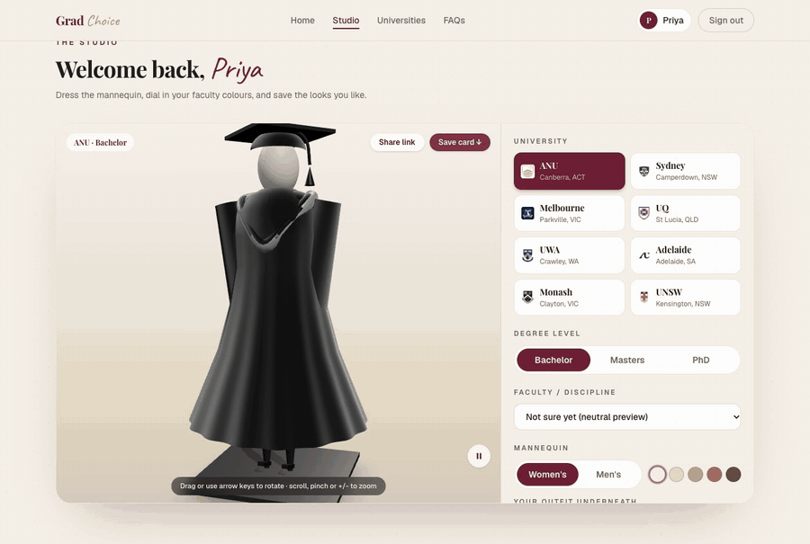

# Grad Choice: Go8 Regalia Configurator

[](https://github.com/anushagarg-10/go8-regalia-configurator/actions/workflows/ci.yml)

**Live demo: https://go8configurator.netlify.app** (no sign-up needed, go
straight to [the studio](https://go8configurator.netlify.app/studio))

A 3D configurator for graduation regalia at Australia's Group of Eight universities.
Pick a university, a degree level, and (where it matters) your faculty, and see the
actual gown, hood, and cap colours on a mannequin you can rotate and zoom.



## At a glance

| | |
| --- | --- |
| **Stack** | Next.js 16 (App Router), React 19, TypeScript, React Three Fiber, Tailwind 4 |
| **Unit and component tests** | 57 Vitest tests: data lookups, both API routes, auth, URL state, and the 3D scene via `@react-three/test-renderer` |
| **End-to-end tests** | 21 Playwright tests on desktop Chromium, with the layout-sensitive ones repeated on a mobile viewport |
| **Accessibility** | axe-core scans against WCAG 2.1 AA on every page, full keyboard control of the 3D viewer, reduced-motion support |
| **CI** | GitHub Actions runs lint, unit tests, a production build, then the Playwright suite against that build |

### How it fits together

```
Browser UI (React, R3F canvas)
   |  fetch
   v
Next.js API routes  (/api/universities, /api/regalia)
   |
   v
src/lib/regalia.ts  (lookup logic, the one place a real backend plugs in)
   |
   v
src/data            (researched regalia data, with sources)
```

The current look always lives in the URL (`/studio?uni=uq&level=phd&faculty=...`),
so any configuration can be shared as a link, and survives a sign-in redirect.

I built this as a portfolio project, learning React Three Fiber and WebGL from
scratch along the way. Partly to get comfortable with real-time 3D on the web,
and partly because it's genuinely hard to find out what your own
academic dress will actually look like before graduation day, especially once
faculty specific hood colours are involved.

## What it does

- Renders gowns, hoods, and caps for ANU, Sydney, Melbourne, UQ, UWA, Adelaide,
  Monash, and UNSW, across Bachelor, Masters, and PhD
- Lets you pick your faculty for the universities where hood colour actually
  depends on it (most of them do). Where I couldn't confirm a colour from an
  official source, the app shows a plain grey placeholder instead of guessing
- Everything on screen is procedural geometry and shader materials built in
  Three.js. No downloaded 3D model files
- You can copy a link to your exact look, or download it as a PNG card
- Open to everyone: the whole studio works without an account. A basic account
  system (stored in the browser, no real backend yet) is only for saving looks,
  and a guest's current look carries through sign-up
- The 3D viewer works without a mouse: arrow keys rotate and tilt, `+`/`-`
  zoom, Home resets, and screen readers hear what changed
- The turntable rotation can be paused, and stays still by default if your
  device is set to reduce motion

## Where the data comes from

Gown, hood, and cap details are taken from each university's official academic
dress regulations, checked against the regalia suppliers those universities
actually use. Sources are recorded next to the data itself in `src/data`. A
handful of colours genuinely vary by faculty and aren't documented publicly in
enough detail to confirm, so those show as "varies" rather than a made up hex
code.

## Running it locally

```bash
npm install
npm run dev              # http://localhost:3000
npm test                 # Vitest unit and component tests
npm run test:e2e         # Playwright E2E + axe-core (starts the dev server if needed)
npm run test:e2e:ui      # same, in Playwright's interactive UI
npm run lint
npm run build
```

The first Playwright run needs a browser: `npx playwright install chromium`.

To run the same E2E and accessibility suite against the live deployment:

```bash
BASE_URL=https://go8configurator.netlify.app npm run test:e2e
```

## Project layout

- `src/data` - the researched regalia data, with sources
- `src/lib/regalia.ts` - the lookup logic (the one place a real backend would
  plug in later)
- `src/lib/auth.ts` - localStorage based demo auth
- `src/app/api` - the two API routes the UI actually talks to
- `src/app/studio` - the 3D configurator itself, open to guests
- `src/components/scene` - the mannequin and regalia geometry, plus the
  keyboard-accessible 3D viewer
- `e2e` - Playwright end-to-end and axe-core accessibility tests
- `playwright.config.ts` - runs against the dev server locally and the
  production build in CI, always on port 3000
- `scripts/record-demo.mjs` - records the README demo GIF
- `.github/workflows/ci.yml` - the two CI jobs (unit tests and build, then E2E)

## Tests

**Unit and component (Vitest, 57 tests).** The data lookup logic, both API
routes, the auth flow, shared-look URL parsing, the open-redirect guard, and a
handful of assertions on the 3D scene itself (material colours, mannequin
variants) using `@react-three/test-renderer`, so they run headlessly.

**End to end (Playwright, `e2e/`).** Real browser runs of the flows people
actually use:

- Using the studio as a guest, and a guest's look surviving sign-up
- Signing up, signing in, and bad passwords
- A shared look link surviving the trip through login
- Off-site `?next=` redirects being refused
- Switching university, level, faculty, and mannequin, with the URL kept in sync
- Saving, restoring, and removing looks across reloads
- Copying a share link to the clipboard
- Driving the whole configurator, 3D viewer included, from the keyboard

**Accessibility (axe-core).** `e2e/accessibility.spec.ts` scans the landing
page, login, the studio as a guest, and the signed-in studio against WCAG 2.1 A and
AA rules, and fails the build on any violation. Alongside that:

- The 3D viewer is focusable. Arrow keys orbit and tilt, `+`/`-` zoom, Home
  resets, and each change is announced to screen readers through a live region
- The turntable rotation has a pause button (WCAG 2.2.2) and is off by default
  for anyone with reduced motion turned on in their OS
- Every form control has a proper label

The E2E suite also caught two real bugs that unit tests missed:

- After signing in from a shared link, the studio read the URL before the
  client-side redirect had updated it, so the shared look was silently replaced
  with the defaults
- Running the suite against the live site showed that saving a look straight
  after switching university, before the new data arrived, saved it under the
  previous university's name. A test now slows the API down to reproduce it

The README demo is recorded by a script, so it stays current:
`npm run demo:record` (with the app running) drives the studio with Playwright
and converts the video to `docs/demo.gif` with ffmpeg.

## Not done yet

- Real accounts. Supabase is the obvious next step, and the auth and data
  layers were written with that swap in mind, so it shouldn't touch the UI
- A proper human figure instead of the procedural mannequin. I tried this on the
  [`experiment/human-figure`](https://github.com/anushagarg-10/go8-regalia-configurator/tree/experiment/human-figure)
  branch and it doesn't work yet: the clothes sit at fixed coordinates tuned for
  the mannequin, so on a differently proportioned body they float. The fix is to
  attach each garment to a bone in the skeleton instead

## About the data and the universities

This is an independent project, not affiliated with any university. University
marks shown in the app are their own public site icons, used only so you can
tell which university you're looking at. Colours are close approximations for
a portfolio demo, not colour matched to any official standard. Please don't
order real regalia based on anything shown here.
